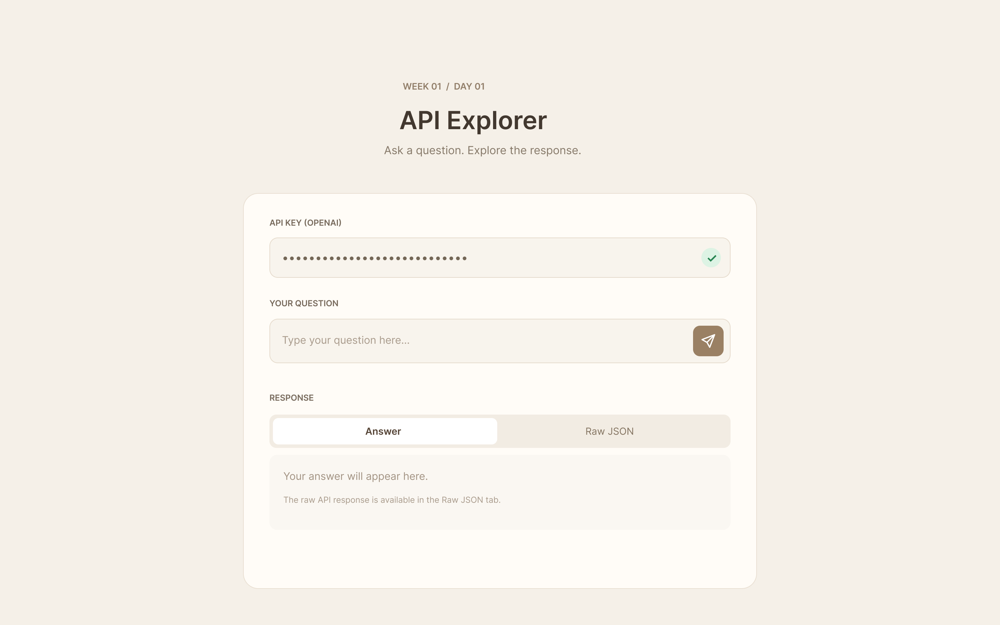
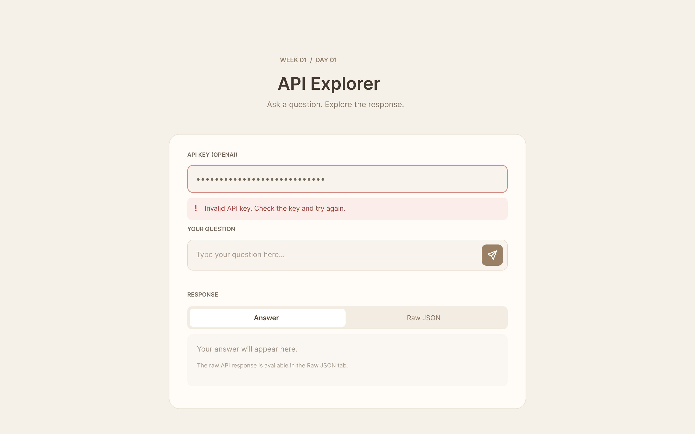

# API Explorer

A small Day 1 AI Engineering project built with HTML, CSS, vanilla JavaScript, and native `fetch()`. It runs as a static local page with no backend, build tools, package manager, or runtime CDN dependencies.

## Features

- Manually entered, masked OpenAI API key with an accessible show/hide toggle.
- Automatic key check after a 600 ms pause in typing, with loading feedback and Send enabled only after verification succeeds.
- Prompt submission to the Responses API using `gpt-5.4-mini`.
- Answer and Raw JSON tabs. Answer supports Markdown headings, emphasis, lists, links, code, and tables.
- Locally vendored marked.js and DOMPurify; generated HTML is sanitized before insertion. Raw JSON is displayed as text.
- Sanitized authentication, HTTP, network, and timeout feedback.

## Run locally

1. Keep `index.html`, `styles.css`, `app.js`, and `vendor/` together.
2. Open `index.html` directly in a modern browser (`file://`). No server or installation is needed.
3. Enter your own OpenAI API key into the API key field. Do not put it in source files or share it in chat, screenshots, or logs.
4. Wait for verification and the green check, then enter a question and press Send (or Enter).
5. Read the formatted Answer or select Raw JSON to inspect the sanitized response.

The verification request retrieves model metadata from `/v1/models/gpt-5.4-mini`. A successful check confirms that request worked; it does not guarantee permission to generate responses, sufficient quota, or working billing. Requests time out after 60 seconds and are not automatically retried. Generation may incur OpenAI API charges.

## Browser and CORS limitations

Internet access and an API account with suitable model permissions and quota are required. Browser local-file policies, CORS, extensions, firewalls, or network conditions can prevent direct API calls. A browser fetch failure may provide no readable HTTP status; JavaScript cannot reliably distinguish CORS from DNS/TLS, connectivity, or browser blocking. Only a readable HTTP 401 is labeled an invalid key.

If a request fails, inspect only the browser's sanitized error category. Do not copy authorization headers or export network logs containing credentials. Do not disable browser protections or add a proxy automatically. Compatibility outside the manually tested browser is not established.

## Security

**This is an educational local prototype, not suitable for production client-side API key storage or handling.** The key is kept only in the current page's memory, is not logged or saved by the application, and is cleared on page navigation. It is transmitted in an authorization header only to the configured OpenAI API endpoints, never in URLs. The eye button intentionally reveals it on screen when requested.

Browser JavaScript, extensions, developer tools, and compromised local scripts can access the key. Input masking and autocomplete hints do not establish a secure credential boundary or control third-party password managers. Never distribute a copy containing a real key. A production application needs a separately reviewed credential architecture.

Responses are redacted before display. Markdown HTML passes through DOMPurify with restricted tags, attributes, and link schemes; images, scripts, forms, styles, and embedded content are excluded. If rendering is unavailable, the Answer falls back to plain text. Responses may still contain sensitive content: avoid submitting secrets and review links before following them. `store: false` is sent for response generation, but does not guarantee zero provider retention.

## Design

[Default state](design/default_state.png) · [Invalid key state](design/Invalid_state.png)

## Design and third-party notices

The approved screenshots and screenshot-derived token estimates are in `design/`. Project instructions are in `AGENTS.md`. Local library versions, sources, and licenses are documented in [vendor/README.md](vendor/README.md): marked 18.1.3 (MIT) and DOMPurify 3.4.17 (distributed with its Apache-2.0 license and upstream dual-license notice).

## Validation

The user manually tested and approved API key visibility, real API requests, and Markdown rendering in the browser. Earlier automated checks exercised mocked API success/failure paths, verification cancellation, timeouts, redaction, tabs, Markdown parsing, and safe rendering fallback. They did not use real credentials.

Pre-commit review checks local assets and HTML references, JavaScript loading, library hashes/notices, the Markdown sanitization boundary, intended commit contents, secret patterns, ignore rules, and Git whitespace errors. Pattern scans cannot prove that every possible secret is absent. DOMPurify attack-payload behavior has not been independently exercised in a real browser by the coding agent; the user's Markdown rendering check is not a full security audit.
