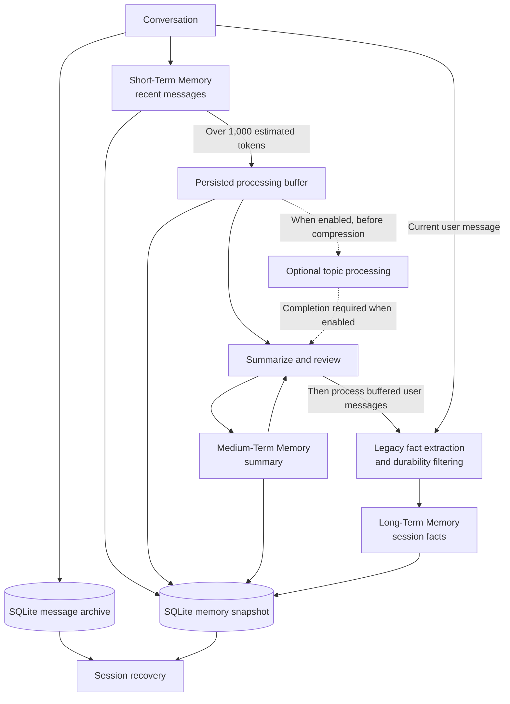

# Day 12 — Personalization

Day 12 starts from the completed Day 11 lab with an independent **Labs → Week 3** workspace. Week 3 uses short-term dialogue, a compressed summary, and extracted session facts with the existing Manager, providers, tools, logs, and session statistics. Original dialogue remains in SQLite. Personalization features are not implemented yet.

Week 1 and Week 2 remain available. Week 3 sessions, history, and memory use separate `week3_sessions`, `week3_history_events`, and `week3_session_memory` SQLite tables; shared providers and tools remain available across the lab. The complete Week 3 history is loaded when a session opens.

## Three-layer session memory



The active legacy extractor processes the current user message and eligible buffered user messages. Its model-guided durability filter is not a guarantee that every transient detail is excluded. The optional topic pipeline is separate: when configured, it runs before summary compression and stores topics in its own SQLite tables; it is not enabled by the standard backend configuration.

## Run locally

Use Node.js with built-in SQLite support and the project's pnpm dependencies. From `d12/`, run these in separate terminals:

```sh
pnpm server  # SQLite API on 127.0.0.1:3003
pnpm dev     # frontend on 127.0.0.1:5175
```

The database is `d12/data/sessions.sqlite`, separate from previous days. Configure providers through the application; do not commit databases or credentials. The inherited development ports are unchanged and cannot be shared with a running Day 11 instance.

Automatic instruction detection is disabled by default. For an explicitly approved isolated test, the server operator may set both `DAY12_INSTRUCTION_DETECTOR_PROVIDER=openai` and `DAY12_INSTRUCTION_DETECTOR_MODEL` to a model in the server's local OpenAI registry before startup. A saved credential for that provider is required; the server does not take detector configuration from browser requests. Invalid or partial configuration prevents startup. Registry membership does not guarantee account access or model availability. OpenCode detector configuration is not supported until server-side context limits are available.

To disable future detector executions without a restart, send `SIGUSR2` to the confirmed backend process. This does not cancel a detector operation already admitted or any in-progress persistence; those operations may still complete. Re-enabling requires an explicitly configured restart. Detector usage is stored with the associated session and run as `extraction` metering, separate from answer usage. A metering failure fails detection rather than silently discarding its record.

## Verify

```sh
pnpm test
pnpm typecheck
pnpm build
node --test server/session-integration.mjs server/sliding-integration.mjs server/week3-integration.mjs
```

The Week 3 integration check exercises session isolation and restart persistence. For inherited architecture and tool details, see the [Day 10 README](../d10/README.md).

## Independent QA

Day 11's focused reconciliation retest covered the formerly failing extractor identity in a mocked Manager-to-SQLite regression; that exact identity was not observed in the final live samples. Prior QA reports and local captures are not part of this project copy.
