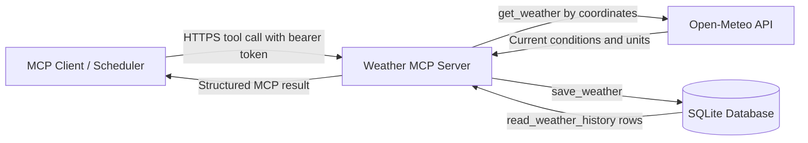

# Day 18 Weather MCP Server

A Scheduler or other MCP client can fetch current weather, save selected observations, and query history over authenticated HTTPS. The caller controls collection frequency. Each request uses stateless MCP Streamable HTTP at `/mcp`.



The [HTTPS handler](src/http.ts) validates Host, Origin and bearer credentials. [Tool handlers](src/mcp.ts) validate arguments and call the [Open-Meteo adapter](src/provider.ts) or [SQLite repository](src/repository.ts). The [composition root](src/main.ts) loads configuration and starts the service.

## Tools and storage

| Tool | Arguments | Successful result |
| --- | --- | --- |
| `get_weather` | `location: {latitude, longitude}` | `{observation}`. Fetching does not save a row. |
| `save_weather` | `observation`, as returned by `get_weather` | `{id, created}`. A duplicate returns the original ID and `created: false`. |
| `read_weather_history` | `location`, inclusive `from`, exclusive `to`, optional `limit` (1–200, default 100) and `offset` (default 0) | `{records: [{id, observation}], nextOffset}`, oldest first. A null offset ends pagination. |

Open-Meteo supplies modelled current conditions at 15-minute intervals. Each observation contains coordinates, `observedAt`, 2 m air temperature (°C), 2 m relative humidity (%), 10 m wind speed (km/h), a numeric WMO conditions code, units and source. Provider units are checked. Temperature is stored as a signed SQLite REAL. See the [provider documentation and usage terms](https://open-meteo.com/en/docs).

Coordinates must be in range and are rounded to five decimal places. Timestamps require an explicit offset and are normalized to UTC milliseconds. A unique constraint on coordinates, observation time and source makes saves idempotent. The first accepted value wins. Authenticated callers share one collection and may submit observations themselves. The database retains normalized measurements. The server has no internal scheduler, resource subscriptions or asynchronous delivery.

## Configure and run locally

Run commands from the Weather project directory with Node.js 24.12+ in the 24.x series, npm and OpenSSL 3. Install and verify the locked dependencies:

```sh
npm ci
npm run typecheck
npm test
```

The following example sets up a **new** private configuration directory for loopback use. Choose an unused port. Set `MCP_HOST` to the intended private IPv4 address before certificate generation for a LAN deployment. Reuse an existing deployment's configuration when restarting it.

```sh
export WEATHER_CONFIG_DIR="${WEATHER_CONFIG_DIR:-$HOME/.config/day18-weather}"
export WEATHER_DATA_DIR="${WEATHER_DATA_DIR:-$HOME/.local/share/day18-weather}"
export MCP_HOST="${MCP_HOST:-127.0.0.1}" MCP_PORT="${MCP_PORT:-3018}"
(
  set -eu
  umask 077
  mkdir -p "$(dirname "$WEATHER_CONFIG_DIR")" "$WEATHER_DATA_DIR"
  mkdir "$WEATHER_CONFIG_DIR"
  openssl req -x509 -newkey ec -pkeyopt ec_paramgen_curve:P-256 -noenc -days 365 \
    -subj '/CN=Weather MCP' -addext "subjectAltName=IP:$MCP_HOST" \
    -addext 'extendedKeyUsage=serverAuth' \
    -keyout "$WEATHER_CONFIG_DIR/server.key" -out "$WEATHER_CONFIG_DIR/server.pem"
  {
    printf 'MCP_AUTH_TOKEN='
    openssl rand -hex 32
    printf 'MCP_HOST=%s\nMCP_PORT=%s\n' "$MCP_HOST" "$MCP_PORT"
    printf 'TLS_CERT_PATH="%s/server.pem"\nTLS_KEY_PATH="%s/server.key"\n' "$WEATHER_CONFIG_DIR" "$WEATHER_CONFIG_DIR"
    printf 'DATABASE_PATH="%s/weather.sqlite"\n' "$WEATHER_DATA_DIR"
  } > "$WEATHER_CONFIG_DIR/server.env"
)
```

Start the compiled server with the private environment file:

```sh
node --env-file="$WEATHER_CONFIG_DIR/server.env" dist/src/main.js
```

See [.env.example](.env.example) for the full template.

| Setting | Meaning |
| --- | --- |
| `MCP_HOST`, `MCP_PORT` | Client-facing loopback or private IPv4 address and port. Defaults to `127.0.0.1` and `3018`. The HTTPS Host must match. |
| `MCP_BIND_HOST` | Optional listening address. Defaults to `MCP_HOST`. The Docker example listens on the container bridge. |
| `MCP_AUTH_TOKEN` | Shared secret, 32–512 token characters. Generate 32 random bytes as hex and supply it to trusted backends. |
| `TLS_CERT_PATH`, `TLS_KEY_PATH`, `DATABASE_PATH` | Required absolute runtime paths. The database parent must exist and be writable. |
| `MCP_ALLOWED_ORIGINS` | Optional comma-separated exact HTTPS origins. Backends may omit Origin. |
| `PROVIDER_TIMEOUT_MS` | Open-Meteo request timeout, default 8000 ms (100–30000). |
| `LOG_DIRECTORY`, `LOG_MAX_BYTES` | Optional macOS capture settings for `dist/src/service.js`. Default to the database parent and a shared 10,000,000-byte cap. |

## Docker

Build from this directory, or load the exported image on a compatible Linux ARM64 Docker engine:

```sh
docker build -t day18-weather-mcp:1.0.0 .
# For an exported release:
docker load -i day18-weather-mcp.tar
```

Using the configuration and shell variables above, start the container as the local non-root user. Use a dedicated data directory for each running instance. The bind mount preserves SQLite and its sidecar files when the container is replaced. Publishing on the selected host address limits network exposure.

```sh
docker run -d --name day18-weather --restart unless-stopped \
  --user "$(id -u):$(id -g)" --env-file "$WEATHER_CONFIG_DIR/server.env" \
  -e MCP_BIND_HOST=0.0.0.0 -e TLS_CERT_PATH=/run/weather/server.pem \
  -e TLS_KEY_PATH=/run/weather/server.key -e DATABASE_PATH=/var/lib/weather/weather.sqlite \
  --mount "type=bind,src=$WEATHER_CONFIG_DIR/server.pem,dst=/run/weather/server.pem,readonly" \
  --mount "type=bind,src=$WEATHER_CONFIG_DIR/server.key,dst=/run/weather/server.key,readonly" \
  --mount "type=bind,src=$WEATHER_DATA_DIR,dst=/var/lib/weather" \
  -p "$MCP_HOST:$MCP_PORT:$MCP_PORT" --log-driver local --log-opt max-size=2m --log-opt max-file=4 \
  day18-weather-mcp:1.0.0
docker logs -f day18-weather
```

The foreground and container entry points write structured events to stdout and native diagnostics to stderr. A macOS LaunchAgent can run `dist/src/service.js` to capture both streams in rotating `server.log` and `error.log` files. Follow `requestId` and `invocationId` to trace a call.

## MCP client integration

Configure the Scheduler backend with server name `d18-mcp`, transport `Streamable HTTP`, endpoint `https://<MCP_HOST>:<MCP_PORT>/mcp`, and header `Authorization: Bearer <shared-secret>`. Deliver the public certificate and bearer secret through trusted channels. Verify the certificate fingerprint independently. For a Node client, set `NODE_EXTRA_CA_CERTS` to the verified certificate path before starting the process.

Initialize the SDK client, call `tools/list`, then invoke `get_weather`. Check `isError` and pass its `structuredContent.observation` to `save_weather`. Query `read_weather_history` for reporting. The [independent SDK client](tests/live.ts) demonstrates this sequence. Its default run saves observations, so use a verification database for smoke tests.
