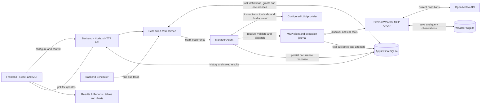

# Day 18 — Scheduler & Background Tasks

Day 18 runs scheduled agent instructions on the backend. A task owns its schedule, timezone, provider, model and unattended tool permissions. It can run with the browser closed. The Scheduler shares the Manager and MCP execution runtime with the application’s agent labs.

## Architecture



The backend timer finds due work and the task service claims each occurrence in SQLite. The Manager invokes the configured provider and feeds tool results back into its execution loop. React sends commands, polls for updates and renders persisted results. Rendering a chart makes no LLM call. See the [scheduler engine](server/scheduler-engine.mjs), [task service](server/scheduled-tasks.mjs) and [scheduled turn](server/scheduled-turn.mjs).

## Run locally

Use Node.js 24.12 or newer with TypeScript stripping and built-in SQLite, and pnpm 10. From the repository root:

```sh
cd d18
pnpm install --frozen-lockfile
pnpm server
```

In a second terminal in the same directory, run `pnpm dev` and open [the application](http://127.0.0.1:5182). Vite forwards API requests to the loopback backend on port 3018. The backend creates `data/sessions.sqlite` on first start. Native credential storage uses macOS Keychain. An existing deployment with a custom Keychain service prefix can set `DAY18_KEYCHAIN_NAMESPACE` to that prefix. Use the container setup on systems without macOS Keychain.

## Configure and run a task

1. In **Providers**, configure a tool-capable provider and model. In **Tools → Add custom tool → MCP Plugin**, register the target server using its deployment URL (for example, `https://weather.example.test/mcp`), transport and authentication settings. Enter secrets through the application's credential controls. The backend initializes the connection and discovers its tool schemas.
2. In **Scheduler → Create Scheduler**, enter instructions, select a provider and model, and choose a one-time or fixed-interval schedule, a local start time and an IANA timezone. Select any required MCP servers and explicitly authorize unattended execution. Grants cover the selected tools available at consent time. Newly discovered tools require renewed consent.
3. A new task starts **Pending**. **Start** enables scheduling. **Pause** suspends future admissions, **Continue** resumes the schedule, and **Stop** deactivates it. An admitted execution can finish. **Delete** archives the task and preserves execution history. Use the history icon above the task list to inspect deleted tasks.
4. Keep the backend running. It restores enabled schedules on startup, coalesces missed intervals and prevents overlapping executions of the same task. The backend checks permissions at dispatch, journals each attempt and flags uncertain external writes for review before they can be repeated.

MCP supports Streamable HTTP and legacy HTTP with SSE. For a private HTTPS issuer, verify the public certificate independently and place it under `data/mcp-tls/<connection-uuid>/<hostname>_<port>.pem` on the backend. TLS hostname and IP checks remain enabled. Authorized typed resource links can also produce background notifications. See [resource watches](docs/mcp-resource-watches.md).

## Weather collection and reporting

Configure two tasks against a separately deployed Weather MCP server. The **collector** calls `get_weather` for the configured location, then passes the returned observation to `save_weather`. The Weather server retrieves current conditions from Open-Meteo and owns the observation database. Repeated collection can return an existing observation when the provider timestamp has not advanced.

The **reporter** calls `read_weather_history` for a bounded period and pages through the results. Ask it for the observation count, temperature range and mean, mean humidity, mean and maximum wind speed, units, conditions and reporting period. Report empty periods or missing measurements explicitly. For trends, request a table and separate charts for measurements with different units. The [example task definitions](examples/weather-tasks.mjs) show how to configure both jobs against an existing catalog.

**Execution History** lists the short execution ID, local start and completion times, duration and status. Select the ID for inline MCP attempts, arguments, results and errors. **Results & Reports** renders the saved agent output as text, Markdown, JSON, tables or line, bar and pie charts. Observation tables display local time and measurement units. The application database retains the original response and scheduled timestamp.

## Docker

From `d18/`, build both production images and start the services:

```sh
docker compose build
docker compose up -d
docker compose ps
```

Open [the container application](http://127.0.0.1:8085). Set `DAY18_PORT` to change the local port and `TZ` to choose the backend timezone. Both containers share a network namespace. The frontend proxies same-origin API requests to the backend on loopback, preserving its local-client checks. Only the frontend port is published. The backend stores SQLite, logs and credentials in the named `day18-data` volume. Container credentials are filesystem-protected plaintext. Limit access to the volume and its backups.

The Dockerfile has separate `frontend` and `backend` targets, tagged by Compose as `day18-frontend:1.0` and `day18-backend:1.0`. To use exported images, load both archives with `docker load -i <archive>` and run `docker compose up -d --no-build`. Configure the provider and reachable MCP endpoint in this instance. Use `docker compose down` to stop the services while retaining data.

## Verification

```sh
pnpm test
node --test server/*-integration.mjs server/*.node-test.mjs
pnpm typecheck
pnpm build
```

The regression suites use isolated databases and controlled providers and MCP servers. They cover autonomous scheduling, restart recovery, authorization, history, weather collection and report rendering. Scheduler lifecycle and execution events are written to `data/logs/scheduler.ndjson`.
