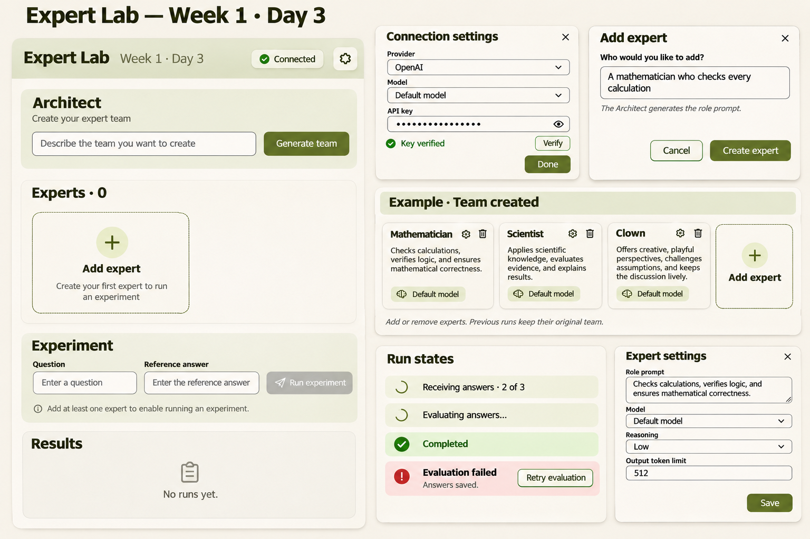

# Expert Lab — Day 3

Expert Lab lets you use an Architect to generate and edit a team of experts, run their answers against a question, and compare AI evaluations with a reference answer. Expert cards support model settings and duplication; run history retains captured settings, answers, verdicts, usage, and retry attempts. Results include accessible details dialogs and manual verdict overrides.

## Getting started

```sh
git clone https://github.com/Lexsv/challenge.git
cd challenge/d3
pnpm install --frozen-lockfile --ignore-scripts
pnpm dev
```

Prerequisites: Node.js 22.13+ and pnpm 11. The install skips dependency lifecycle scripts; the lockfile includes the platform-specific esbuild package. Open the local URL printed by Vite, normally http://127.0.0.1:5173.

## Commands

```sh
pnpm typecheck
pnpm test
pnpm build
pnpm preview
```

`pnpm preview` serves the production build locally after `pnpm build`. Tests use mocked requests and do not need an API key. No environment file is required.

## Connection and data

Open Connection settings, enter your own OpenAI API key and select a model. You may use Verify to test the connection; generation and experiment requests use your key and may incur API charges. Requests go directly to the official OpenAI API. Never put a real key in source files, shared documents, or a URL.

The key is retained in `sessionStorage` for the current tab's page session when storage is available. It is masked on reload and verification resets; restoration makes no automatic request. `sessionStorage` is accessible to JavaScript on the same origin and is not a secure vault. Browser session restoration may retain the key after a tab or browser closes. Use **Forget key** to remove it from application state and storage; already-sent requests are not canceled. If storage is unavailable, the key stays in memory only and the app displays a notice. Experts and run history are kept in memory and reset on reload.

## Design

[View the Expert Lab design](design/expert-lab-design.png)



The design illustrates the original visual direction; the implemented interface includes subsequent improvements.
