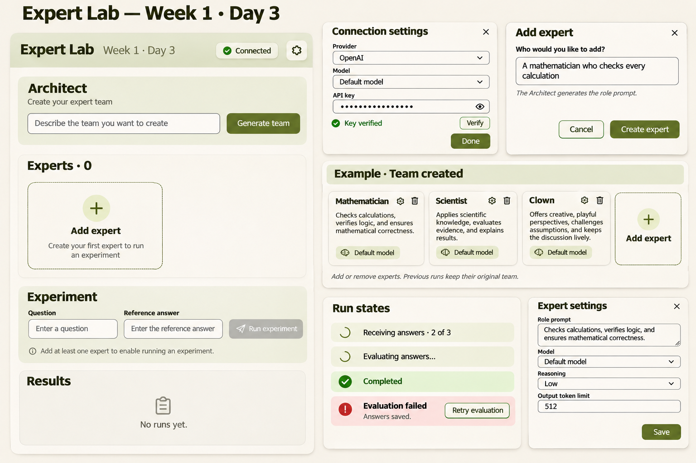

# Expert Lab — Day 5

Expert Lab is a browser-based AI experiment workspace for comparing experts across models and configurations. Day 5 focuses on configurable providers, controlled parameter experiments, and reports that make answers, performance, and costs easier to compare.

## Features

- Create, configure, and duplicate experts; select a provider and model for each expert.
- Experiment with enabled key-value API parameters, including `reasoning_effort` and `temperature`. Disabled parameters are not sent.
- Run experts against a question, optionally evaluate answers against an expected answer, and inspect responses and technical errors.
- Review in-memory run history, captured settings, retries, token usage, and request costs when pricing or provider-reported costs are available.
- Compare expert configurations in a report and export the current session's comparison as a PDF. Unknown or partial costs remain identified.

## Install and run

Prerequisites: Node.js 22.13 or later and pnpm 11.

```sh
git clone https://github.com/Lexsv/challenge.git
cd challenge/d5
pnpm install --frozen-lockfile --ignore-scripts
pnpm dev
```

Open [http://127.0.0.1:5173/](http://127.0.0.1:5173/). The development server uses a fixed port and reports an error if it is occupied.

## Environment and API keys

No `.env` file is required. Open **Settings**, configure OpenAI or OpenCode Console, enter your own API key, and select a model. Verification and experiment requests are initiated by the user and may incur provider charges. OpenCode Console verification uses a model selected from its catalog; catalog availability alone does not verify a key.

Keys for the built-in connections are held in browser memory and reset on reload. Experts, runs, and verification state also reset on reload. Custom provider definitions may be retained in browser session storage without their keys; custom provider execution is not currently available. Never commit keys or place them in URLs or shared files.

The Vite development server includes a narrowly scoped OpenCode Console proxy to handle browser CORS. A static production build does not include that development proxy, so serving it elsewhere requires suitable CORS or an equivalent trusted proxy.

## Architecture

The React and TypeScript interface collects expert settings and displays runs. A provider registry routes requests to the OpenAI and OpenCode adapters, while the execution engine records immutable configuration snapshots and normalized results. Comparison and PDF modules derive their output from the current in-memory history; they do not make additional model requests.

## Testing and build

```sh
pnpm typecheck
pnpm test
pnpm build
```

Automated tests use mocked provider requests and do not require an API key. `pnpm build` produces the Vite production files in `dist/`.

## Design references

These existing mockups document the design direction and may differ from the current interface:

- [Expert Lab design](designs/expert-lab-design.png)
- [Provider overview](designs/providers-overview.png)
- [Custom provider dialog](designs/custom-provider-modal.png)


