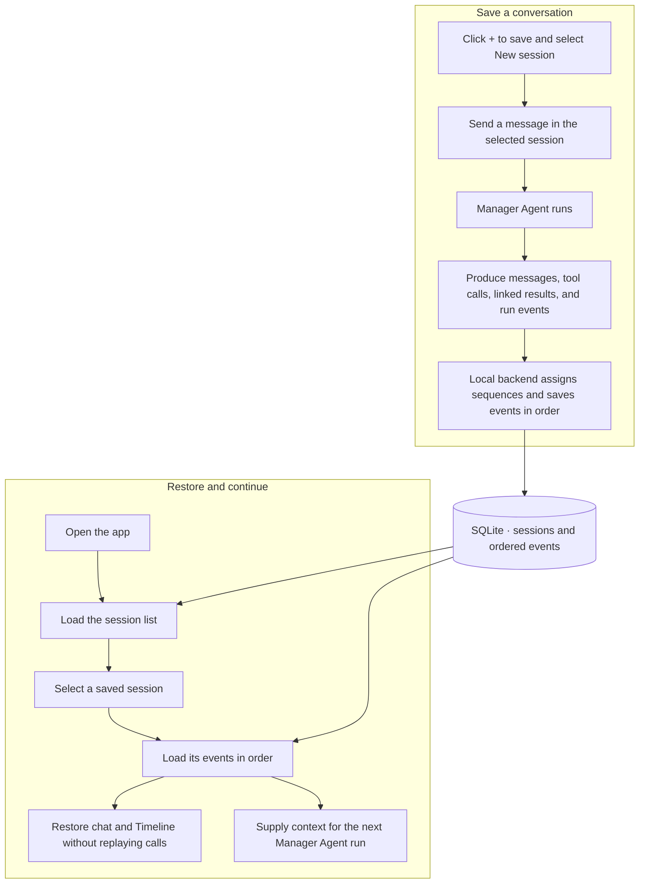

# AI Engineering Challenge — Day 8 Baseline

This is the Day 8 starting baseline, copied from the tracked `d7/` project at finalized Day 7 commit [`52fa1281ae2fd4060453e36cc67dd122fc7c1992`](https://github.com/Lexsv/challenge/commit/52fa1281ae2fd4060453e36cc67dd122fc7c1992). The visible application labels and page title identify Day 8; the inherited Day 7 behavior is preserved. Day 8 feature work is reserved for a later commit.

The inherited Day 7 implementation includes a session sidebar with SQLite-backed session metadata. Conversation history is saved as ordered SQLite events.

## Design Preview

Day 8 design assets have not been added yet.

## Design Gallery

Design gallery will be documented in [designs/README.md](designs/README.md) as Day 8 visuals are created.

## Day 8 baseline overview and learning objectives

This baseline preserves the finalized Day 7 manager-agent workflow where:

- a **Manager Agent** decides when to call tools,
- tools are executed through a shared **Tool Registry**,
- results are shown in a **technical timeline**,
- and calculations remain deterministic in local tools.

Learning goals:

- model + provider configuration hygiene,
- tool contract design and validation,
- browser-safe HTTP tool integration,
- clear timeline observability for tool runs.

## Application architecture

Main areas:

- **Labs**
  - Week 1 experiment studio
  - Week 2 Agent Tool Lab (manager + timeline)
- **Agents**
  - create/edit agent prompts and model parameters
- **Tools**
  - built-in catalog + custom tool cards (non-executable custom tools)
- **Providers**
  - provider credentials, model lists, verification, parameter settings

Core runtime pieces:

- `main.tsx` initializes provider registry and shared tool registry.
- `manager-agent.ts` runs the manager loop, records tool executions with timestamps/status.
- `tool-runtime.ts` defines executable built-in tools and validation/dispatch.
- `week2-agent-tool-lab.tsx` renders timeline and tool execution details.

## Manager Agent and tool execution workflow

1. User message enters Week 2 lab.
2. Manager LLM response may include tool calls.
3. Manager executes each tool via `ToolRegistry.executeById(...)`.
4. Tool execution (args, output/error, status, duration) is recorded.
5. Timeline shows the event stream: USER / tool events / manager/system / AGENT response.

## Tool execution types

Execution type is metadata separate from built-in/custom origin:

- **Function**
- **HTTP API**
- **Agent**
- **Library**

Built-in tools currently use:

- `builtin.tax_calculator` → Function
- `builtin.currency_converter` → Function
- `builtin.exchange_rate` → HTTP API

## Built-in tools

- **Tax Calculator** (`builtin.tax_calculator`)
  - input: `amount`, `taxRate`
  - output: `taxAmount`, `total`
- **Currency Converter** (`builtin.currency_converter`)
  - input: `amount`, `fromCurrency`, `toCurrency`, `exchangeRate`
  - output: deterministic local conversion
- **Exchange Rate** (`builtin.exchange_rate`)
  - input: `fromCurrency`, `toCurrency`
  - output: `exchangeRate`, `rateSource`

## Frankfurter HTTP API integration

The exchange-rate tool uses Frankfurter over HTTP via `HttpExchangeRateSource`.

- Endpoint base: `https://api.frankfurter.dev/v1`
- Browser-safe direct request path (no redirect dependency)
- timeout, argument validation, HTTP error, malformed payload, and missing-rate handling

Current limitations of provider integration:

- rate availability depends on Frankfurter-supported currencies/pairs,
- live rates are external and time-varying,
- automated tests mock HTTP and do not depend on live provider uptime.

## Providers and model configuration

- OpenAI and OpenCode connections can be configured in-app.
- Credentials are entered in **Providers** (no required `.env` file).
- Verification and live runs may consume paid tokens.
- Week 2 session metadata and conversation history persist locally. Provider credentials, drafts, agents, and Week 1 history reset on reload.

## Install and run

Requirements:

- Node.js 22.13+
- pnpm 11+

```sh
cd d8
pnpm install --frozen-lockfile --ignore-scripts
pnpm server # terminal 1: local SQLite backend on 127.0.0.1:3001
pnpm dev    # terminal 2: Vite UI on 127.0.0.1:5173
```

Open `http://localhost:5173/`.

## Typecheck, test, build

```sh
pnpm typecheck
pnpm test
pnpm build
```

- Tests use mocked provider/tool HTTP behavior.
- Production bundle output is written to `dist/`.

## Known limitations

- Week 2 messages, run states, and tool calls/results persist. Drafts and provider configuration remain in memory.
- Custom tools are cataloged in UI but not executed as dynamic runtime plugins.
- Full manager end-to-end runs require valid provider credentials.

## Future improvements

- richer tool authoring + execution for custom tools,
- retry/backoff strategy for HTTP tools,
- optional persistence for additional application settings,
- expanded built-in tool set and stronger observability.

## Design documentation

See [designs/README.md](designs/README.md) and the linked design assets.

## Day 7 session storage

The local backend uses Node's built-in `node:sqlite` (Node 22.13+; verified on Node 26). No additional SQLite dependency is needed. It initializes `data/sessions.sqlite` safely on startup with `CREATE TABLE IF NOT EXISTS`. The database and SQLite sidecar files are excluded from Git. Vite proxies `/api/sessions` to the loopback backend; run `pnpm server` and `pnpm dev` in separate terminals. A static frontend build alone does not serve the session API.

In Labs → Week 2, clicking **+** asks the backend to save a new session with a stable ID, the title **New session**, and its creation time. After the save succeeds, the app adds and selects its row and opens an empty chat. The row menu offers Rename and confirmed Delete. Failed operations keep the last successfully saved state; deleting a session removes its metadata and history in one transaction.

Sending a message starts a Manager Agent run in the selected session. The agent saves user and assistant messages, run transitions, tool calls, and linked tool results through the local backend as they occur. Each immutable SQLite event has a stable event ID, session ID, backend-assigned sequence, type, and JSON payload. A tool call is saved before execution, and its result refers to the same execution and tool-call IDs. Retrying an event save does not create a duplicate or execute a tool again. Updates from a pending run remain attached to the session where it started, even if another session is selected.

On startup, the app loads the saved session list and selects the first session if one exists. Selecting a saved session loads its events in sequence and rebuilds its conversation state, chat, and Timeline. Restored messages and saved tool observations supply context for the next Manager Agent run. History is loaded once per session per page lifetime; switching between mounted chats preserves in-memory drafts and pending runs. Sessions created before history persistence simply have no events to restore.

Reopening a session **does not rerun old tool calls** or automatically resume an old run. A saved call with no recorded result appears as **incomplete** in the Timeline. A failed history save stops the run; Retry saves pending events without replaying the tool. Unsaved events can be lost if the app closes while storage is unavailable. Provider keys and configuration are separate from conversation history: credentials are not written to SQLite, and forgetting keys does not prevent saved conversations from being opened and read.



Browser acceptance scenario (manual; requires a configured provider):

1. Open Labs → Week 2 and click **+**. Rename the session so it is easy to find later.
2. Ask: “Convert 100 CAD to JPY.” Wait for completion, then note the JPY amount and inspect its saved tool call and linked result in the Timeline.
3. In the same session, ask: “Convert 100 USD to EUR.” Wait for completion. Both conversions and their results should remain visible in that session.
4. Close and reopen the app. Keep the local backend running, or restart it against the same database, then select the saved session. Confirm that both conversations and their Timeline events have been restored without any new tool executions.
5. Ask: “Apply 10% tax to the JPY amount from the first CAD-to-JPY conversion. Use the saved JPY result; do not fetch the exchange rate again.”
6. The agent should use the first conversion's saved JPY amount, not the later EUR result. If that amount is `J`, the tax should be `0.10 × J` and the total `1.10 × J`, subject to displayed rounding. Inspect the new run: it may call the local Tax Calculator, but it should not fetch another exchange rate or replay either old conversion. Earlier event IDs and results should remain unchanged.

This browser scenario is an acceptance checklist, not a claim that a live currency conversion was executed. Automated tests use temporary SQLite databases, deterministic model responses, and mocked HTTP. `pnpm test:server` verifies session metadata across backend restart; the conversation-history and session-action tests cover ordered restoration, follow-up context, no replay, incomplete calls, deletion, and session isolation.

## Ordered conversation history

`history_events` stores one immutable event per row: stable event ID, session ID, backend-assigned per-session sequence, type, and JSON payload. Startup adds the table without modifying session records. Older sessions start with no events. The API exposes GET/POST `/api/sessions/:id/events`; an exact retry of an event ID returns the existing event, while a conflicting reuse returns 409. Payloads are limited to conversation contracts; provider configuration and credentials are never sent to this API.

The Manager Agent awaits each save. It records messages and run transitions, saves tool calls before dispatch, and saves each result linked to the original execution ID and tool-call ID. A storage failure stops the run; Retry saves the queued event and restores state without invoking a tool or resuming the old run. Closing the browser while storage is unavailable can lose unsaved events. A restored call with no result is visibly incomplete; it is never executed automatically.

Selecting a session loads its history once per page lifetime. Mounted chats preserve drafts and pending runs during switches; each writer retains its originating session ID. Saved tool observations are included as data in future model context. The tool catalog and definitions are unchanged.

`src/conversation-history.test.ts` uses a temporary SQLite database, deterministic Manager LLM responses, and the real tax tool. It verifies call-before-execution, persisted total 115, idempotent saves, backend restart, restored Timeline, follow-up total 230, no replay, incomplete calls, and isolation of a second session. No live model calls or credentials are needed.

Manual browser review: create two sessions, calculate tax in one, switch away while a run is pending, then return. Restart the backend and reload, select the calculation session, inspect its Timeline, and send a follow-up using the prior total. The second session must remain empty. Stop the backend during a save and check Retry; retrying must not dispatch the old tool again. Live model checks require configuring credentials manually in Providers.

## Session layout and send feedback

Sessions appears before the chat in DOM order and in a 220px left column on desktop. `session-send.ts` owns validation, acceptance, and the synchronous duplicate-send lock. An accepted submission clears only its session's draft and displays a Send-button spinner until settlement; blocked validation preserves the draft.

## Verify, remember, and forget provider keys

The existing API Key field and Verify action in OpenAI and OpenCode Console settings now handle credential saving. A newly entered key is sent only to the local backend, verified against its fixed official provider endpoint, and saved in macOS Keychain only on success. A failed candidate verification does not replace an existing saved key. Save remains available for temporary in-memory credentials and provider settings. There is no separate Remember panel. Custom provider settings and the existing tool catalog remain unchanged.

A page-level controller first fetches saved-key presence for each supported provider, including any legacy saved Go key, and deduplicates React StrictMode mounts. No saved key means Not verified and zero verification POSTs or upstream requests for that provider. The label stays Not verified while the presence request is pending; this lookup does not display a spinner. Only a positive presence result starts one background verification, with a spinner scoped to that provider while its Verify request is pending. A failed presence request is retryable and never starts verification. Manual Verify accepts a newly entered key regardless of the startup presence result. Saved OpenAI keys use the authenticated models endpoint; Console uses a single-token request to a paid model from the existing bundled catalog because its public model catalog cannot verify authentication. Console checks can consume tokens. Header and Providers indicators show Verified, Not verified, or red Not authorized for explicit credential rejection. Checks in progress use a compact labelled spinner. Focusable tooltips provide canned explanations and retry guidance for inconclusive checks, timeouts, rate limits, permissions, or transport/store failures. Verify remains the button label while a check runs. HTTP 403 is treated as inconclusive permission failure rather than proof that a key is invalid. Retry is available in Providers and through Verify. Keys are never returned to the browser.

Forget key clears that provider's saved and temporary credential and verification status. Forget all keys in the Providers header requires confirmation and clears all saved provider accounts and temporary credentials. Neither action removes a provider, endpoint, model selection, or parameter template. Removals are reported per provider; failed or unconfirmed removals remain visible and retryable. Both frontend and backend invalidate pending verification generations. Backend saves and removals use per-provider mutation queues, so even a Keychain save already in progress cannot recreate a key after Forget completes.

Credential code is isolated in `server/credentials.mjs`, `server/keychain.swift`, and `src/saved-credentials.ts`. The helper uses the installed Swift runtime and Security framework with stdin/stdout pipes, never credential command arguments or logs. It queries only service `local.lex.challenge.d7.provider-credentials.v1` and the exact selected provider account. Presence checks request attributes, not password data. Credentials never enter SQLite or browser storage. Requests use fixed official provider endpoints with redirects disabled, and upstream errors are not forwarded. No user account or sign-in is required. No Keychain operation runs at module import/server startup; background checks are triggered by the UI.

Conversation persistence is independent. Forgetting credentials never touches session/history tables. History loads remain available with no configured key; only sending new messages requires a credential. Drafts and current runs remain session-scoped.

Automated tests use only fake credentials, fake Keychain stores, and mocked provider responses. Coverage includes verify-before-save, retaining an old key on failure, startup/reload deduplication, explicit rejection, transient failures, stale verification after Forget, partial removal failures, provider isolation, and backend-only saved-key requests. The acceptance test saves a real deterministic tax-tool result, forgets all keys, restarts the backend, fetches the same session and exact history rows, and rebuilds chat/Timeline without replaying tools.

Manual checks remaining: inspect desktop/narrow layout and provider dialogs; verify a test key using the existing field; reload and observe Checking… followed by status; use both forget actions, including while verification is pending; reload and reopen an existing conversation. Actual macOS Keychain permission prompts and live provider checks are manual. Automated checks do not access existing secrets or Keychain entries. Restart `pnpm server` for the updated credential routes and use `pnpm dev` for the UI.

## Local credential-route troubleshooting

`pnpm server` is a separate Node process and does not watch backend source changes. A browser hard reload only reloads the frontend. After changing `server/sessions.mjs` or `server/credentials.mjs`, stop and restart `pnpm server`.

The reported `/api/credentials/openai/verify` 404 was reproduced on both port 3001 directly and port 5173 through Vite: both returned `{"error":"Not found."}`. The running backend started at 12:17, before credential routing was added at 12:29. Restarting it loaded the current handler; a malformed-JSON probe then returned `400 {"error":"Invalid JSON."}` through both paths. These probes exit before saved-key presence or key reads. The frontend proxy was forwarding correctly; the old backend had no credential route. Empty-store behavior and successful manual verification are exercised only against fake stores and mocked upstream responses.

## Provider status presentation

`credential-indicator.tsx` is shared by the header, provider summary, and provider configuration dialog. Explanations appear in MUI tooltips on hover and keyboard focus; the focusable wrapper has a visible focus outline. The spinner has a provider-specific accessible label. Generic failures and HTTP 403 permission failures remain Not verified; only an explicit credential rejection uses red Not authorized. Raw provider error text is never shown in these tooltips. Forget errors remain visible as action errors so failed removals are not hidden. This presentation change does not modify verification requests, Keychain handling, or session/history behavior.

Presentation tests cover labels, neutral inconclusive states, red rejection, spinner accessibility, keyboard-focusable tooltip targets, and sanitized explanations. Browser visual review is still required when browser automation is available.

## Week 2 provider picker and session actions

The chat provider picker offers OpenAI and OpenCode Console only. A legacy in-memory OpenCode Go selection remains readable, but Send is blocked until a supported provider is selected. History is never rewritten to change providers. The Go adapter remains available to other existing application features.

Each session row has a trailing keyboard-accessible three-dot menu containing Rename and Delete; right-click continues to open the same menu. Rename retains its existing behavior. Delete opens a confirmation naming the session and explaining that all its history will be permanently deleted. Cancel does not call the backend. The row stays until successful deletion; errors remain in the confirmation for retry. Deleting the selected session opens an empty chat while leaving other sessions available.

`DELETE /api/sessions/:id` removes history rows and session metadata in a single SQLite transaction. It is idempotent for safe deletion retries. Event writes recheck session existence after reading the request body, and SQLite foreign keys enforce session ownership. Pending runs cannot insert events for a deleted session or recreate its metadata; tool calls awaiting their pre-execution history save are not dispatched if that save is rejected. Deletion never touches provider credentials or Keychain.

`src/session-actions.test.ts` uses temporary databases and deterministic model responses. It covers cancellation, deletion of a full calculation history, keeping another session intact across restart, transaction rollback on an injected failure, late writes from a pending run, failed deletion UI state, duplicate confirmation, accessible row actions, and legacy Go send validation. Manual review: inspect the picker and row menus, cancel then confirm a deletion, verify the selected chat becomes empty, and reload to confirm the deleted row stays gone. Restart `pnpm server` to load the new DELETE endpoint before reviewing the UI.

## Library tool: js-tiktoken request metering

Week 2 runs `js-tiktoken` locally before every Manager Agent model request, including every follow-up request after tool execution. It is the first **Library** tool, with a distinct amber label in Tools and Timeline. It runs automatically; it is not an LLM-callable function and is excluded from the tool definitions sent to the model. Week 1 experiments and credential checks retain their existing workflows.

The tokenizer counts the entire serialized outgoing JSON body: instructions/system messages, restored history, prior tool results, current input, role framing, and callable tool definitions. Headers and credentials are excluded. JSON framing is an approximation of provider-side input formatting; the estimate is not billed usage. Only `o200k_base`/`cl100k_base` mappings known to the installed `js-tiktoken` model map are used, plus an explicit list of newer local GPT-5 model IDs covered by the [official OpenAI tiktoken GPT-5 encoding rule](https://github.com/openai/tiktoken/blob/main/tiktoken/model.py), checked 2026-11-10. Unknown model names do not receive a guessed fallback: the item says **Estimate unavailable**. Encoding ranks are bundled and lazy-loaded locally, with no CDN/token-counting service calls.

Each model request has one **Library · js-tiktoken** Timeline item with a stable request ID. The pre-request snapshot displays **Estimated input tokens** and, if rates are known, **Estimated input cost**. After the response it updates the same item with provider-reported **Actual input**, **Actual output**, **Total**, and **Estimated request cost**. Missing usage remains **Not reported**, distinct from an actual zero. Request failures and interrupted requests keep their own item; reopening history never issues a model request.

Pricing is a dated snapshot, not a bill. The current rate sources are the existing OpenCode Console catalog and the [official GPT-4o Mini model page](https://developers.openai.com/api/docs/models/gpt-4o-mini) for its alias and dated snapshot (standard text USD rates, checked 2026-11-10). Other OpenAI models, custom endpoints, Go pricing, unknown actual response models, incomplete input/output usage, or unavailable applicable rates display **Cost unavailable**. Cached input is discounted only when a matching rate is known. The pre-request estimate uses uncached input rates. Currency, per-million rates, source, and snapshot date are saved with the numeric estimates; requested-model and actual-model pricing are kept separate. Account discounts, provider fees and other billing adjustments are not calculated.

History stores immutable `metering` snapshots linked to session, run and request ID. Rebuilding the Timeline folds the snapshots into one item per request. The metering payload has numeric counts/costs and bounded model/library/pricing metadata; it never duplicates prompts, tool arguments, raw provider responses or credentials. Startup migrates the event table's allowed-type constraint in a transaction, preserving existing session IDs and every existing history row. Failed saves retain their stable event IDs for safe retries. A pre-request meter must save before the provider is contacted. Incomplete restored meters remain visible without replay.

Tests in `token-meter.test.ts` and `token-meter-history.test.ts` use placeholders, mocked provider responses, real local tokenization and temporary SQLite databases. They cover supported/unsupported encodings, full outgoing input coverage, pre-request persistence, multiple requests, missing versus zero usage, missing and cached pricing, failed requests, request identity, old-schema migration, Timeline restoration and isolation. Tokenizer rank chunks add bundle size; they load only when their encoding is needed. History selection and budget enforcement are described below.

## Token-budgeted Manager history

Before each Week 2 answer request, the app uses **`js-tiktoken` locally** to estimate the full input, including the current message, instructions, and tool definitions. It adds whole prior turns from newest to oldest, stopping at the first turn that would exceed the session target or the model’s available input budget. Selected turns are sent in chronological order. The complete dialogue remains in SQLite, and this selection makes no summarization call. If required content alone exceeds the session target, it can still be sent when it fits the model budget.

A positive session target is capped by the model’s available input budget; zero uses the model budget. The available budget reserves space for a reply and an estimation safety margin. An explicit provider context-overflow response can trigger one retry after removing an older selected turn, without repeating completed tools. Existing saved summaries remain readable history but are not sent in new requests.

## Week 2 chat presentation

Messages stay left-aligned on the light chat background. User bubbles retain their border and reuse the selected session row’s pale-blue theme background, with no User label. Agent replies use primary text without a message border or separate background. Each run's internal activity appears under a **Logs** disclosure, collapsed by default. Expanding it reveals the existing steps in their original order with a small indent; each tool or Library detail disclosure works independently. Chevrons follow the final visible label or status. Type labels retain their assigned colors, names and descriptions use primary text, and statuses use green for Completed, red for Failed, and muted gray for Running; separate orange error styling is preserved. This grouping changes presentation only; saved events and the Timeline data remain intact.

The composer grows to six text rows, then scrolls its draft internally. Its circular 40px Send button stays inside the field with an 8px bottom/right inset and reserved text space. Enter sends and Shift+Enter inserts a newline; validation, duplicate-send protection, disabled states, and the sending indicator retain their existing behavior. The empty, single-line, multiline, and scrolling layouts were reviewed in an isolated browser fixture with generated drafts. Active Logs and nested disclosures were also reviewed with generated data; completed/reopened Logs have automated rendering coverage, with full-session browser review still a follow-up. No real provider or Keychain access was used for those UI checks.


## Day 8 Vintage Pink & Blue Pastels

The shared theme uses near-white surfaces, pink accents, and pale blue selected sessions, user messages, and controls. `src/vintage-palette.ts` holds the shared fill, ink, border, and status colors; `src/theme.ts` applies them across navigation, forms, dialogs, tool tables, and both Labs weeks. Darker blue and pink inks keep controls and type labels readable, with explicit hover, keyboard-focus, selected, and disabled states. Completed stays green, Failed stays red, the separate error status stays orange, and Running uses muted gray. Theme tests check at least 4.5:1 contrast for body/status text on the pastel surfaces and for control/tool-label color pairs.

Browser palette review uses generated session history and empty credential status responses: Providers, provider settings, Agents, the Add Agent dialog, Tools, Labs Week 1, and Week 2 chat with a selected session and expanded Logs. It does not call a live provider or access Keychain entries. Layout, event ordering, session persistence, and agent/tool behavior are inherited unchanged.


## Week 2 session stats

A persistent **Session stats** panel follows the selected session. Desktop uses three columns: Sessions, chat/composer, and the 430px stats panel (stacking below chat before the large-screen breakpoint). On narrow screens they stack in that order. The chat header keeps its settings gear; there is no information icon. Stats use bold labels and regular, right-aligned values without explanatory paragraphs. Missing token usage is **Not reported** and missing cost is **Unavailable**. Input/output totals include available provider-reported values only; Total tokens sums those two known subtotals and is Not reported when neither exists. Token/cost subtotals have no visible Partial qualifier. Cost (≈) sums complete available request-cost estimates at full precision and rounds only the displayed currency total to three decimal places. Rows are grouped with whitespace only: models/requests, reported token totals, active time/cost, then context. Each model appears once, most recently requested first. The centered Context section shows **Model window**, **Dialogue**, **Compaction target**, and **Last request**. Dialogue counts the full saved conversation, including history replaced by summaries, but excludes system instructions, tool definitions and the draft. Session settings save a valid non-negative whole-number **Compaction target** when the gear popover closes; blank/invalid input retains the last successful save. The default for unset/new sessions is **0 (Auto)**. Existing saved positive values are retained. Positive targets are session-specific SQLite metadata and survive provider/model switches and reloads; Providers has no limit field.

Auto displays the model’s full catalog window with an `(Auto)` suffix (or `Auto` when unknown). History selection uses the available input budget after the reply reserve and safety margin. The model budget remains the hard limit; a session target guides selection of older turns.

**Last request** displays the locally estimated input size of the latest dispatched answer request. Provider-reported usage is included separately in the token totals. The estimate is persisted and restores when the session reopens.


`src/session-stats.ts` contains reusable, read-only aggregation over restored conversation state. It folds request-meter snapshots by stable request ID, counts retry and summary requests independently, and lists unique provider-reported model names in reverse request order (falling back to the recorded request model when none was reported). A late usage snapshot cannot promote an older request. Actual input/output usage is summed independently; missing values are shown as missing, while reported zero remains zero. Active time sums valid durations of completed Manager runs, excluding idle gaps and unfinished/failed runs.

Estimated cost sums complete `estimatedRequestCost` values with currency metadata. Input-only projections are excluded; partial coverage shows the known subtotal and absent coverage shows **Unavailable**. Currency subtotals are kept separate. These estimates are not billed totals.

Manager estimation uses the complete serialized answer payload, the model-specific encoding when available, and local `o200k_base` fallback otherwise. Persisted meters contain request kind and numeric sent-input estimate without copying prompts, credentials or raw provider responses. The model budget retains its output reserve and uncertainty margin in both Auto and custom modes. OpenCode Console window/output metadata comes from the existing public catalog parser and is loaded for the selected model; missing metadata remains unknown.


Tests use fake meters, persisted-event restoration, and mocked providers. Browser review uses a separate temporary SQLite database with generated sessions and a no-key credential store; it does not read Keychain or alter existing Day 7 or Day 8 saved databases.

The persistent-panel browser review used the actual Day 8 components with generated data in an isolated static fixture. It checked a long unbroken title, multiple models, partial and missing usage/pricing, optional compaction counts, and stacked layout at a narrow effective viewport. A desktop screenshot was captured. Automated checks cover session isolation and shared request estimates; no live-provider or Keychain verification was performed.


### Day 8 verification review

The isolated session-stats review backend in `/private/tmp` deliberately injected an HTTP 503 for every upstream provider call. A placeholder Verify request reproduced local HTTP 200 with `saved: false`, `verification: "retryable"`, and `reason: "http-503"`. That response came from the review fetcher, not a real OpenAI request or a Day 8 verification-handler change. Day 7 and Day 8's tracked credential handlers and controller flow were identical when compared. The normal backend is started with `pnpm server`; the isolated review backend must be stopped first. Real-provider/Keychain verification is left to the user and was not performed in this review.

Credential indicators retain Day 7's green Verified and neutral outlined Not verified appearance in the header and settings. The settings dialog gives canned feedback distinguishing a temporary failure from explicit credential rejection; failed verification leaves any saved key untouched. Fake-store/mock-response tests cover a retryable 503 followed by success, shared header/dialog status, rejection, restart, and stale-response protection. Sidebar titles occupy one ellipsized line with visible actions; full chat titles wrap, including unbroken strings, without shrinking the icon group.


### Session pair restoration and context updates

After loading a session's ordered events, Week 2 restores the provider and requested model from its most recent recorded model request, including failed/interrupted requests. Later usage snapshots do not reorder requests. The selection stays local to that chat; changing another session or a global OpenAI default cannot overwrite it. Sessions with no recorded pair use the existing defaults. Unavailable saved pairs produce a visible fallback warning before sending. Send remains disabled until history and selection restoration finish.

History selection and restoration tests use the real Manager flow with mocked provider responses, fake credentials and temporary SQLite databases. They cover whole-turn selection, soft session targets, model-budget rejection, overflow retry, and restoration of saved dialogue and the last dispatched input estimate. They do not constitute live-provider validation.


### Day 8 history paging

Opening a saved Week 2 session fetches its newest 20 Manager turns and scrolls to the latest message after rendering. Returning to a mounted session also opens at the bottom. Scrolling near the top (or selecting **Load older messages**) fetches older turns with a stable sequence cursor and snapshot. A page always contains complete runs, keeping each turn’s messages, Logs, tool calls/results and request metrics together. Prepending retains the viewport offset and deduplicates events by their stable IDs.

The first page includes session-wide run/request accounting and cached dialogue token counts, so Session stats does not report only the visible page. Manager loads the full saved event history before a new run; UI pagination never limits context or compaction. Old tool calls are never replayed. Failed steps or a failed Manager run mark the collapsed group **Logs · Failed**, using the existing error color for both text and chevron; restoration derives this styling from persisted events.

`history-pagination.test.ts` exercises three pages (20/20/6 turns), complete run boundaries including a late saved call, snapshot stability, duplicate-free merging, full Manager context, session isolation, dialogue counts, and failure styling after an isolated SQLite backend restart. Browser checks use a separate temporary database and an empty fake credential store.

### Saved Console model capabilities

**Refresh Models** saves the normalized public OpenCode Console catalog in Day 8’s browser local storage, scoped to its configured endpoint. It retains modalities, tools/reasoning support and levels, structured-output support, limits and pricing. A new registry restores this metadata synchronously, so icons and capability details are available after reload without another catalog request. Refresh replaces the saved snapshot, including missing or explicitly unsupported capabilities. Invalid/older snapshots fall back to the bundled catalog. Credentials are never part of this cache.

`model-catalog-storage.test.tsx` verifies reload restoration without another request, endpoint isolation, stale-response rejection, replacement and malformed snapshots. The isolated mocked browser check confirmed a request count of one before and after reload, including the restored Image/PDF and reasoning details card.
