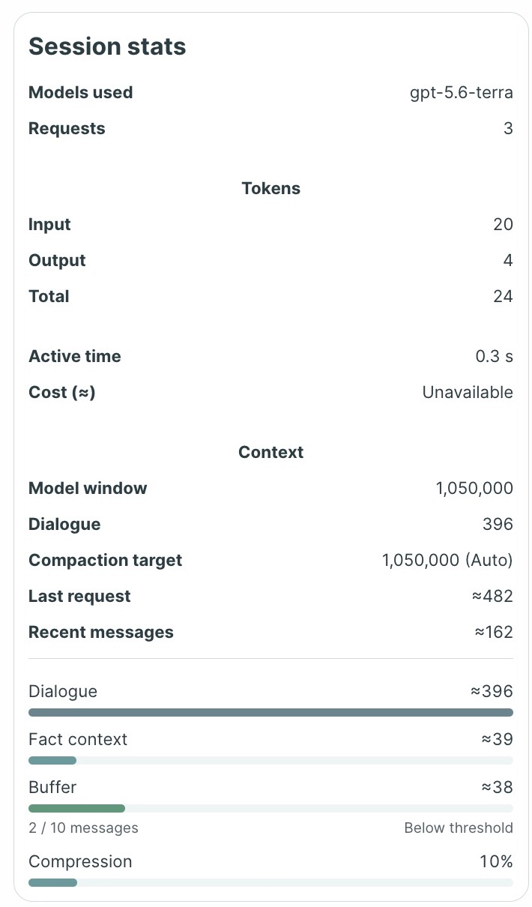

# Day 9 — Context Management

Day 9 adds per-session context strategies to the Week 2 Manager. **Key Facts** keeps a structured fact table alongside a verbatim message window; **Token budget** retains the Day 8 newest-first, whole-turn history trimming. Both preserve the full saved dialogue in SQLite. See the [Day 8 README](../d8/README.md) for the inherited architecture, providers, and tools.

## How context compression works

```text
Saved dialogue in SQLite (never replaced)
        │
        ├── Fact context: extracted facts + coverage marker
        ├── Buffer: older, uncovered messages (verbatim)
        └── Recent messages: latest N messages (verbatim)
                         │
          Fact context + Buffer + Recent messages → answer
```

While the buffer is at or below capacity and the complete request fits the model's input budget, the Manager sends saved facts, the uncovered buffer, and the recent window, including the current question. When the buffer exceeds `N`, the Fact Extractor processes the older uncovered messages. The merged facts and their coverage marker are saved together; subsequent answer requests use those facts in place of the covered messages. A local estimate can also trigger extraction early when the request would exceed the model input budget. If extraction or saving fails, the previous facts and coverage remain in place.

With **N = 10**, counting user and assistant messages:

- At **20 messages**, the buffer contains messages **1–10** and the recent window contains **11–20**. The buffer is full.
- On **message 21**, the buffer exceeds capacity. The extractor processes **1–11**, saves the facts and coverage, and the answer request contains those facts plus **12–21** verbatim. The buffer is empty immediately after extraction; it can show **1 / 10** after the answer is added.
- Later turns reuse the saved facts and accumulate uncovered messages until the next extraction.

Session stats estimates tokens locally with `js-tiktoken`. **Compression** displays `Fact context tokens ÷ Dialogue tokens`: for example, **39 ÷ 396 ≈ 10%**. The buffer bar shows message occupancy, not token share.



## Run and verify

From `d9/`, install the locked dependencies with `pnpm install --frozen-lockfile`, then run `pnpm server` and `pnpm dev` in separate terminals. Open <http://127.0.0.1:5173/> and select **Labs → Week 2**. Configure a provider in the app to send requests.

Run `pnpm test` for the Day 9 suite, `pnpm test:server` for SQLite integration, and `pnpm typecheck` for TypeScript. Automated provider and history fixtures use synthetic data and mocked responses; real-provider results depend on the selected model.
